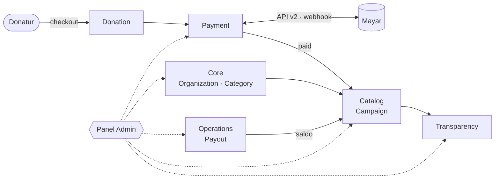

<div align="center">


# Salamaid Crowdfunding

**Platform donasi dan penggalangan dana yang transparan dari donasi pertama sampai dana tersalurkan.**

<p>
  
  
  
  
  
</p>

<sub>
  <a href="#-sekilas">Sekilas</a> ·
  <a href="#-fitur">Fitur</a> ·
  <a href="#-arsitektur">Arsitektur</a> ·
  <a href="#-memulai">Memulai</a> ·
  <a href="#-keamanan">Keamanan</a> ·
  <a href="#-production">Production</a> ·
  <a href="#-dokumentasi">Dokumentasi</a>
</sub>

</div>

<br>

## ✦ Sekilas

Salamaid menghubungkan **donatur**, **lembaga penggalang dana**, dan **tim operasional** dalam satu aplikasi:

- **Donatur** menemukan program, berdonasi lewat Mayar, lalu mengikuti kabar dan laporan penggunaan dana.
- **Lembaga** mengelola profil, kampanye, dan laporan transparansinya sendiri.
- **Tim admin** memverifikasi lembaga, memoderasi kampanye, memantau pembayaran, menyalurkan dana (payout), dan mengaudit setiap keputusan.

<table>
  <tr>
    <td width="33%" valign="top">
      <h4>🤲 Donasi yang mudah</h4>
      Checkout ringkas, status pembayaran real-time, kuitansi yang bisa diunduh, dan riwayat donasi di akun donatur.
    </td>
    <td width="33%" valign="top">
      <h4>🔎 Transparan sejak awal</h4>
      Kabar terbaru, alokasi dana, dan bukti penggunaan dana diperiksa admin sebelum dipublikasikan.
    </td>
    <td width="33%" valign="top">
      <h4>🛡️ Operasional yang aman</h4>
      Akses berbasis role, pemisahan tugas pada payout, audit log, dan bukti pembayaran yang disimpan privat.
    </td>
  </tr>
</table>

<br>

## ✦ Fitur

### Situs publik

| Area | Yang tersedia |
| --- | --- |
| **Penemuan** | Beranda, katalog program, direktori lembaga, profil lembaga dengan tab interaktif |
| **Kampanye** | Cerita, alokasi dana, kabar terbaru, halaman transparansi per kampanye |
| **Donasi** | Checkout donasi, halaman status pembayaran dengan tombol *refresh*, pembuatan ulang tautan bayar |
| **Akun donatur** | Registrasi, login, reset password, inbox notifikasi, riwayat donasi, kuitansi (lihat dan unduh) |
| **SEO & konten** | `sitemap.xml`, `robots.txt`, serta halaman About, Contact, Help, Terms, dan Privacy |

### Panel admin (`/admin`)

| Domain | Kemampuan |
| --- | --- |
| **Lembaga** | Review dan verifikasi (`pending → verified / rejected / suspended`) beserta catatan keputusan |
| **Kampanye** | Moderasi, publikasi, dan pengelolaan kategori |
| **Donasi & Payment** | Monitoring, export CSV, sinkronisasi status ke Mayar, *transaction explorer*, log dan *retry* webhook |
| **Payout** | Alur `requested → approved → paid` dengan cek saldo, pemisahan tugas, bukti bayar privat, rekonsiliasi, dan *risk flag* |
| **Transparansi** | Review kabar dan lampiran bukti penggunaan dana sebelum tayang |
| **Pengguna** | Manajemen pengguna dan role (khusus `super_admin`) |
| **Insight** | Dashboard KPI, laporan dengan export, notifikasi kerja, dan audit log |
| **Konten** | Artikel bantuan, pengaturan aplikasi, dan channel pembayaran |

### Role & hak akses

Permission didefinisikan terpusat di [`config/admin.php`](config/admin.php), lalu ditegakkan berlapis lewat middleware, policy, dan Form Request.

| Role | Fokus |
| --- | --- |
| `super_admin` | Akses penuh (`*`), termasuk pengelolaan role |
| `admin` | Review lembaga, kampanye, dan transparansi; publikasi; kategori; konten bantuan |
| `reviewer` | Review lembaga, kampanye, dan transparansi |
| `finance` | Mengelola payment dan payout |
| `support` | Akses baca untuk membantu donatur dan lembaga, tanpa melihat data rekening |
| `organization_admin` | Mengelola lembaga, kampanye, dan laporan transparansinya sendiri |

<br>

## ✦ Arsitektur

Aplikasi ini adalah monolit Laravel modular ([`nwidart/laravel-modules`](https://github.com/nWidart/laravel-modules)). Setiap domain bisnis menjadi satu modul di `Modules/`.



| Modul | Tanggung jawab |
| --- | --- |
| `Core` | Organisasi, anggota organisasi, kategori |
| `Catalog` | Kampanye dan media kampanye |
| `Fundraising` | Fundraiser |
| `Donation` | Donasi beserta export-nya |
| `Payment` | Payment, channel, fee, webhook, log sinkronisasi Mayar |
| `Operations` | Payout, bukti bayar, risk flag |
| `Transparency` | Kabar kampanye dan lampiran bukti |

**Status pembayaran yang andal.** Status Mayar dipetakan secara eksplisit, transisinya hanya bisa maju (status `paid` tidak bisa turun lagi), dan webhook selalu diverifikasi ulang ke API Mayar sebelum dipercaya. Payment yang masih `pending` disinkronkan otomatis oleh scheduler `payment:sync-pending` setiap 5 menit, dan juga bisa dipicu manual dari panel admin.

<br>

## ✦ Memulai

**Prasyarat:** PHP 8.2+, Composer, Node.js 18+, dan MySQL/MariaDB (test memakai SQLite in-memory).

```bash
# 1. Dependensi
composer install
npm ci

# 2. Environment (isi DB_* dan MAYAR_* di .env, jangan di-commit)
cp .env.example .env
php artisan key:generate

# 3. Database & aset
php artisan migrate --seed      # seeder hanya untuk local/testing
npm run build                   # atau `npm run dev` saat development

# 4. Jalankan
php artisan serve               # http://127.0.0.1:8000
php artisan queue:work          # bila QUEUE_CONNECTION=database
php artisan schedule:work       # sinkronisasi payment pending
```

Panel admin tersedia di **`/admin/login`**. Akun admin hasil seed memakai `SALAMAID_ADMIN_EMAIL` dan `SALAMAID_ADMIN_PASSWORD` dari `.env`. Nilai default-nya hanya untuk lokal; jangan dipakai di server.

### Testing

```bash
php artisan test                                    # seluruh suite
php artisan test --filter=AdminSecurityHardeningTest
php artisan test tests/Feature/Admin                # panel admin saja
```

Suite berjalan di SQLite in-memory, jadi tidak menyentuh database development. Saat ini: **216 test, 2.175 assertion, semua lulus.**

<br>

## ✦ Keamanan

Hardening admin (fase A12) dikunci oleh test otomatis, sehingga regresi langsung terdeteksi di CI:

- **Proteksi route menyeluruh.** Setiap route admin wajib memakai `web` + `auth` + `admin` + `admin.permission`. Route baru tanpa proteksi akan menggagalkan test.
- **CSRF diuji sungguhan.** Bypass bawaan test dimatikan, lalu setiap route non-GET dipastikan menolak request tanpa token (419).
- **Matriks permission.** Setiap role diuji terhadap setiap halaman, termasuk percobaan eskalasi hak akses dan IDOR.
- **Output aman.** XSS ter-escape, link notifikasi menolak skema `javascript:`, dan export CSV dilindungi dari *formula injection*.
- **Rahasia tidak bocor.** Hash password, signature, dan payload mentah dipastikan tidak muncul di halaman, export, maupun audit log.
- **Bukti payout privat.** File disimpan di disk `private` tanpa URL publik, MIME dideteksi dari isi file, dan unduhan memerlukan permission `payouts.manage`.
- **Performa.** Tidak ada N+1: jumlah query di setiap halaman daftar tetap konstan berapa pun jumlah barisnya.

Detail lengkap ada di [`docs/admin-a12.md`](docs/admin-a12.md).

<br>

## ✦ Production

| Kunci | Nilai yang disarankan |
| --- | --- |
| `APP_ENV` / `APP_DEBUG` | `production` / `false` |
| `QUEUE_CONNECTION` | `database`, dengan worker yang dijaga supervisor |
| `MAYAR_ENVIRONMENT` | `production`, beserta `MAYAR_API_KEY` dan `MAYAR_WEBHOOK_TOKEN` |
| `PAYOUT_EVIDENCE_DISK` | `private` |
| `PAYMENT_PENDING_SYNC_ENABLED` | `true` |
| `ADMIN_NOTIFICATION_EMAIL_ENABLED` | `true` bila mailer sudah dikonfigurasi |

```bash
php artisan migrate --force
php artisan config:cache && php artisan route:cache && php artisan view:cache
# cron:  * * * * * php artisan schedule:run
```

Endpoint webhook untuk Mayar: `POST /api/v1/payment/webhooks/{provider}`.
Checklist deployment dan rollback lengkap ada di [`docs/admin-a12.md`](docs/admin-a12.md).

<br>

## ✦ Dokumentasi

| Dokumen | Isi |
| --- | --- |
| [`docs/tahapan-admin.md`](docs/tahapan-admin.md) | Roadmap dan status setiap fase (A0–A12) |
| [`docs/pembagian-tugas-admin.md`](docs/pembagian-tugas-admin.md) | Pembagian kerja antar-agent |
| [`docs/payment-mayar.md`](docs/payment-mayar.md) | Integrasi Mayar: inquiry, webhook, pemetaan status |
| [`docs/admin-a7.md`](docs/admin-a7.md) | Sinkronisasi payment dan queue job |
| [`docs/admin-a8.md`](docs/admin-a8.md) | Payout dan bukti pembayaran privat |
| [`docs/admin-a9.md`](docs/admin-a9.md) | Moderasi transparansi |
| [`docs/admin-a12.md`](docs/admin-a12.md) | Security, konfigurasi production, deployment, dan rollback |

<br>

<div align="center">
  <br>
  <sub>Dibangun dengan Laravel untuk penyaluran kebaikan yang amanah dan terbuka.</sub>
</div>
